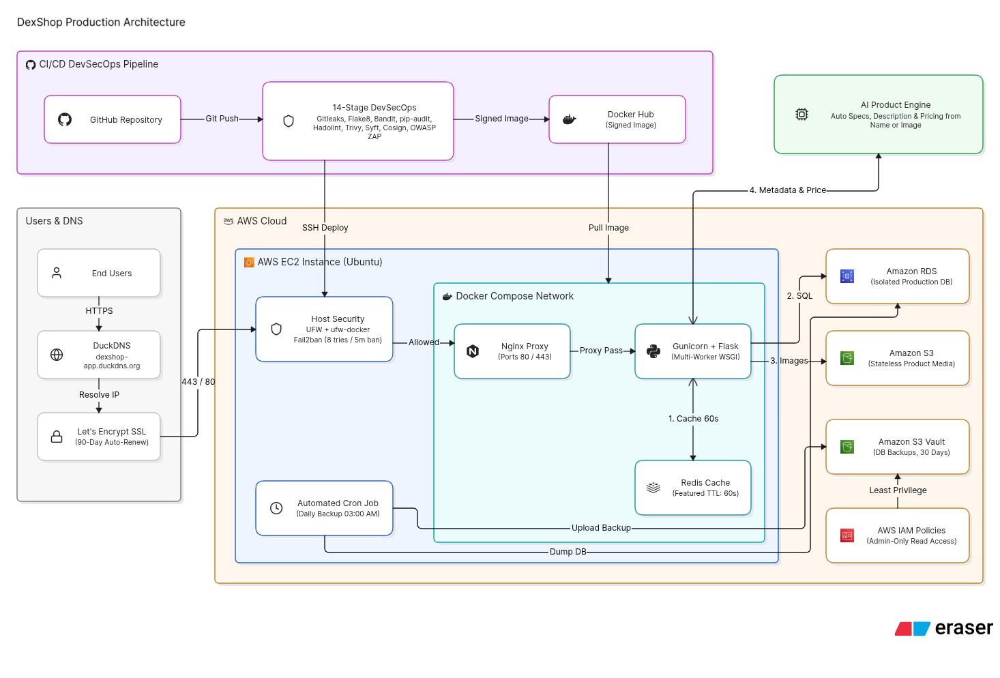

🛒 DexShop — Cloud Migration & DevSecOps Architecture📌 Project OverviewDexShop is an AI-powered e-commerce web application built with Flask (Python). This repository documents the complete Cloud Migration of the platform from a basic PaaS hosting environment (Render) to a scalable, decoupled, and hardened cloud infrastructure on Amazon Web Services (AWS). The project leverages full containerization via Docker Compose and enforces strict security standards through an automated 14-stage DevSecOps CI/CD Pipeline.🚀 Key Milestones & Engineering Highlights1. Code Refactoring & AI IntegrationApplication & UI Refactoring: Restructured the Python codebase to adhere to clean code principles, modular design, and PEP8 standards, alongside a modernized, responsive user interface.AI-Powered Product Onboarding: Integrated generative AI directly into the product management workflow. By simply providing a product name or uploading a product image, the system automatically:Extracts detailed technical specifications and metadata.Generates an engaging, SEO-friendly product description.Suggests an estimated market price based on product attributes.2. Cloud Architecture & Service Decoupling

Compute & Containerization (AWS EC2 & Docker Compose): Packaged the application stack into isolated containers orchestrated via docker-compose, ensuring environment parity between development and production.Reverse Proxy & Concurrency (Nginx & Gunicorn):Nginx serves as the front-facing reverse proxy, handling incoming HTTP/HTTPS traffic and SSL termination.Gunicorn runs as the WSGI application server configured with multiple workers to distribute load and handle concurrent requests efficiently.Database Decoupling (Amazon RDS): Migrated the relational database off the local compute instance to a dedicated, private AWS RDS instance accessible strictly from the application server's security group.Stateless Media Storage (Amazon S3): Offloaded all user-uploaded product images to Amazon S3, keeping the application containers completely stateless and preserving EC2 disk space.In-Memory Caching Layer (Redis): Deployed a dedicated Redis container to cache frequent database queries (such as featured_products) with a 60-second TTL, significantly reducing RDS read IOPS and improving response times.Dynamic DNS & Automated SSL (DuckDNS & Let's Encrypt):Mapped the dynamic EC2 public IP to a persistent domain (dexshop-app.duckdns.org) via an automated DuckDNS update daemon.Secured all traffic with Let's Encrypt SSL/TLS certificates, configured for automated renewal every 90 days.3. Automated Backups & IAM GovernanceScheduled Daily Backups: Configured an automated cron job executing daily at 03:00 AM to dump, compress, and upload a full snapshot of the RDS database to a dedicated Amazon S3 bucket.Lifecycle & Retention Policy: Enforced an automated cleanup mechanism that purges backup archives older than 30 days to optimize storage costs.IAM Privilege Separation (Least Privilege): Implemented strict AWS IAM policies separating write/upload permissions from read permissions—ensuring that the backup service can only upload archives, while only authorized Administrators possess the permissions to read or restore backup data.4. Host & Network Security HardeningFirewall Hardening (UFW & ufw-docker): Locked down host network access using UFW and integrated ufw-docker to prevent Docker from bypassing iptables rules, exposing only ports 80, 443, and 22.Intrusion Prevention (Fail2ban):Configured active monitoring on SSH logs to mitigate brute-force attacks.Enforced a custom policy banning offending IPs for 5 minutes (300 seconds) after 8 failed login attempts.Enabled IP whitelisting (ignoreip) to prevent accidental lockouts for trusted administrator connections.5. 14-Stage DevSecOps CI/CD PipelineEvery code push triggers an automated GitHub Actions workflow comprising 14 sequential security, quality, and deployment gates:StageTool / GateSecurity & Engineering Purpose1Secrets Detection (Gitleaks)Scans source code and Git history to prevent accidental leakage of API keys, passwords, or AWS credentials.2Code Quality (Flake8)Enforces Python coding standards, style consistency, and syntax validity.3SAST Scan (Bandit)Performs Static Application Security Testing on Python code to identify security vulnerabilities early.4SCA Scan (pip-audit)Audits third-party dependencies in requirements.txt against known CVE vulnerability databases.5IaC Scan (Hadolint)Lints the Dockerfile to ensure container build instructions follow security and performance best practices.6License Compliance CheckVerifies open-source dependency licenses to prevent legal or compliance conflicts.7Container Scan (Trivy)Scans the built Docker image for OS-level package and library vulnerabilities before deployment.8SBOM Generation (Syft)Generates a comprehensive Software Bill of Materials (SBOM) documenting all components inside the container.9SLSA ProvenanceGenerates verifiable build provenance metadata to protect software supply chain integrity against tampering.10Image Signing (Cosign)Cryptographically signs the container image to guarantee authenticity and trustworthiness.11Policy as Code (Conftest)Validates infrastructure and configuration files against predefined Open Policy Agent (OPA) security rules.12DAST Scan (OWASP ZAP)Executes Dynamic Application Security Testing against a running instance of the app to detect runtime vulnerabilities.13Publish to Docker Hub (CD)Pushes the verified, scanned, and signed Docker image to the container registry.14Deploy to AWS EC2Connects via SSH using the resilient DuckDNS domain, pulls the latest image, and updates the Docker Compose stack.🛠️ Operations & Verification Commands# 1. Check the status of running containers
sudo docker compose ps

# 2. Verify Redis cache keys and inspect TTL expiration
sudo docker compose exec dexshop-redis redis-cli keys "*"
sudo docker compose exec dexshop-redis redis-cli ttl featured_products

# 3. Stream real-time logs for the application and Nginx
sudo docker compose logs -f

# 4. Monitor Fail2ban status and currently banned IPs
sudo fail2ban-client status sshd
🔮 Future RoadmapAmazon CloudFront (CDN): Integrate CloudFront for global edge caching of static and S3 media assets upon completion of AWS account quota verification.Custom VPC Architecture: Migrate the compute and database layers into isolated Private Subnets behind an Application Load Balancer (ALB) / NAT architecture.Observability & Monitoring: Implement centralized metrics and alerting using AWS CloudWatch or a Prometheus + Grafana stack.
